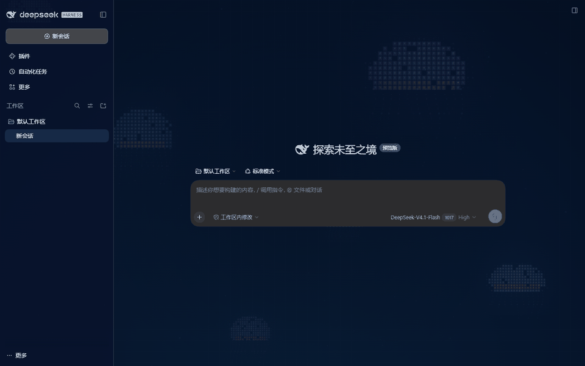

# DSH 深海字符水母背景

[English](README.md#english) · [视觉需求说明](docs/visual-brief.md)



实际界面：[全窗口截图](assets/screenshot.png) · [设置开关与强度滑块](assets/settings.png)

适用于 DSH `0.2.1-rc.3` Web 界面的动态主题插件。它在整个应用窗口后方绘制字符方格水母、暗蓝网格和漂浮星点，并把面板切换为深色半透明外观。DSH 原有的侧边栏、聊天、设置和输入功能继续使用。

动画由 Canvas 实时绘制，不依赖远程图片或视频；背景不拦截鼠标与键盘，页面隐藏时暂停，并响应系统“减少动态效果”设置。

## 使用

首次安装后背景默认开启。打开 **设置 → 通用设置 → 深海字符水母**，可以关闭背景或调整动效强度。关闭时恢复此前选择的主题。启用期间若选择 DSH 的其他外观，该选择会在关闭本插件后生效。

页面隐藏时停止绘制；系统开启“减少动态效果”或动效强度设为 0 时显示静态画面。设置保存在当前浏览器的 `localStorage`，同一来源的多个标签页会同步。

## 安装

需要 DSH `0.2.1-rc.3`。使用仓库中的安装包，安装到 Web profile 后重启 DSH：

```powershell
dsh plugin --profile web add '.\dist\dsh-background-style-plugin-0.1.4.tgz'
dsh web
```

安装版 Desktop 首次启动并初始化 profile 后，完全退出应用，再使用该安装版附带的 `dsh` 命令：

```powershell
dsh plugin --profile desktop add 'D:\path\to\dsh-background-style-plugin-0.1.4.tgz'
```

重新打开 DSH 后首次默认开启。卸载时使用 `dsh plugin --profile web remove dsh-background-style-plugin`，Desktop 则把 `web` 换成 `desktop`。

## 从源码构建

此源码使用 DSH `0.2.1-rc.3` 的 Client 打包工具。将本仓库的插件源码和配置文件复制到该版本源码的 `packages/client/dsh-background-style-plugin`，在 DSH 仓库根目录安装依赖并依次执行：

```powershell
node --max-old-space-size=4096 .\node_modules\typescript\bin\tsc -b tsconfig.host.json
pnpm exec tsdown --config-loader native --env.DSH_BUILD_FACE host
pnpm exec tsc -b packages/client/dsh-background-style-plugin/tsconfig.json
pnpm exec tsdown --config-loader native --config packages/client/dsh-background-style-plugin/tsdown.config.ts --env.DSH_BUILD_FACE client
cd packages/client/dsh-background-style-plugin
pnpm pack
```

构建产物是 Host 入口 `lib/index.js` 和浏览器入口 `lib/client.js`。插件通过 `dsh.bundle` 把自己加入 profile，通过 `dsh.client` 加入浏览器插件表；主题使用 `ctx.theme.register`，设置项使用 `settings.general.item` 插槽。不修改 DSH 源码。

## 限制

此包的 `engines.dsh` 固定为 `0.2.1-rc.3`。其他 DSH 版本需要重新核对插件 API、主题 token 和全窗口背景层级，再调整兼容范围。

视觉参考：小红书《ASCII风格的水母动效制作（提示词分享》，笔记 ID `6ad97ec4000000002c0263ef`。

## 效果预览

仓库中的动图和截图均来自 DSH `0.2.1-rc.3` 的实际运行页面，不是模拟界面。
